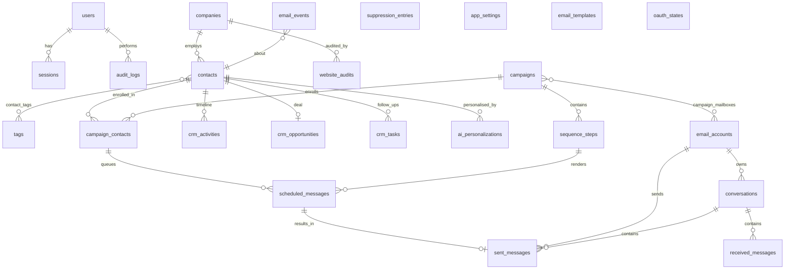

# Database Design

PostgreSQL 16. All primary keys are UUID v4. All tables carry `created_at`/`updated_at` (timestamptz).
Soft deletion (`deleted_at`) on `contacts`, `companies`, `campaigns`. Migrations live in
`apps/api/alembic/versions` and are applied with `alembic upgrade head` (run automatically by the
API container entrypoint).

## Entity relationship diagram

## Tables

| Table | Purpose | Key constraints / indexes |
|---|---|---|
| `users` | Operators (roles: admin, member, viewer) | unique `email` |
| `sessions` | Server-side sessions | unique `token_hash`; idx `user_id`, `expires_at` |
| `companies` | Prospect companies | idx `lower(name)`, `domain`, `state` |
| `contacts` | Leads | partial unique `email` where `deleted_at is null`; idx `company_id`, `lead_status`, `state` |
| `tags`, `contact_tags` | Tagging | unique tag `name`; PK `(contact_id, tag_id)` |
| `email_accounts` | Connected mailboxes; tokens Fernet-encrypted | unique `(provider, email)` |
| `campaigns` | Campaign config + state machine | check on `status` |
| `campaign_mailboxes` | Mailboxes assigned to a campaign | PK `(campaign_id, email_account_id)` |
| `sequence_steps` | Ordered steps of a campaign | unique `(campaign_id, position)` deferrable |
| `email_templates` | Reusable subject/body templates | |
| `campaign_contacts` | Enrollment + per-lead progress | unique `(campaign_id, contact_id)`; idx `(status, next_send_at)` |
| `scheduled_messages` | Send queue | **unique `(campaign_contact_id, sequence_step_id)`** (duplicate-send guard); idx `(status, due_at)` |
| `sent_messages` | Provider-accepted messages | unique `rfc_message_id`; idx `(email_account_id, sent_at)` |
| `conversations` | Threads per mailbox | unique `(email_account_id, provider_thread_id)` |
| `received_messages` | Inbound messages | unique `(email_account_id, provider_message_id)` |
| `email_events` | Append-only analytics ledger | idx `(type, occurred_at)`, `campaign_id`, `contact_id` |
| `suppression_entries` | Global do-not-contact | unique `email` |
| `website_audits` | Audit results + evidence | idx `company_id` |
| `ai_personalizations` | Generated lines, evidence, approval | idx `contact_id`, `input_hash` |
| `crm_opportunities` | Deal value / meeting per contact | unique `contact_id` |
| `crm_activities` | Contact activity timeline (notes, sends, replies, stage changes) | idx `(contact_id, created_at)` |
| `crm_tasks` | Follow-up tasks | idx `(completed_at, due_at)` |
| `audit_logs` | Security / compliance audit trail | idx `(entity_type, entity_id)`, `created_at` |
| `app_settings` | Key → JSONB settings | PK `key` |
| `oauth_states` | OAuth `state` + PKCE verifier, 10-minute TTL | PK `state` |

## Status enums

* `campaigns.status`: draft, scheduled, active, paused, completed, stopped, error
* `campaign_contacts.status`: active, replied, completed, unsubscribed, bounced, stopped, removed, error
* `scheduled_messages.status`: queued, sending, sent, failed, cancelled, unknown
* `contacts.lead_status` (= CRM stage): new_lead, contacted, replied, interested, meeting_scheduled,
  proposal_sent, won, lost, not_interested
* `contacts.verification_status`: unknown, valid, risky, invalid
* `email_events.type`: attempted, accepted, failed, bounced, replied, positive_reply, negative_reply,
  unsubscribed, complaint, meeting_booked

"Accepted" means the provider accepted the message for delivery. The system never records "delivered"
because neither Gmail nor Graph returns delivery confirmation for external recipients.

## Transactions

* CSV imports run inside a single transaction; any database error rolls back the whole import.
* Send reservation and result recording are separate short transactions (the provider call happens
  outside any open transaction so locks are never held across network I/O).
